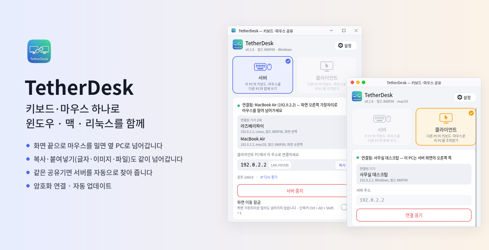
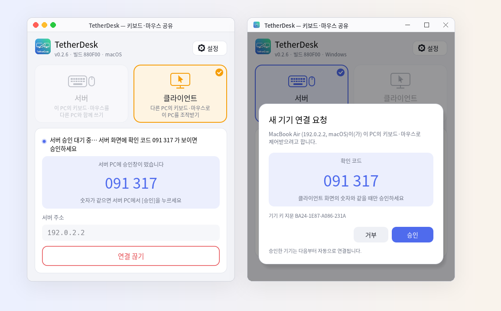
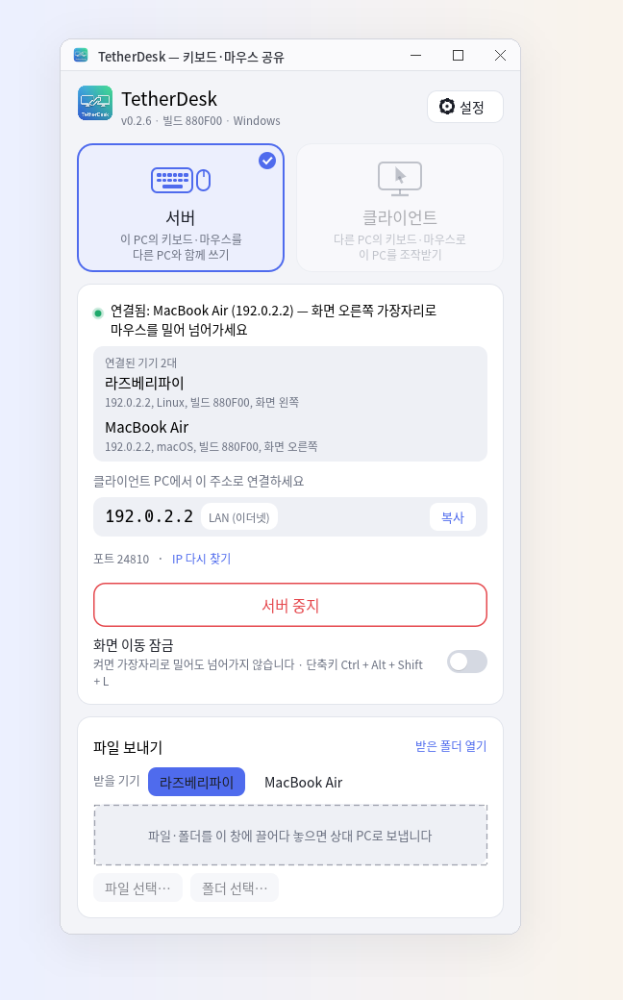
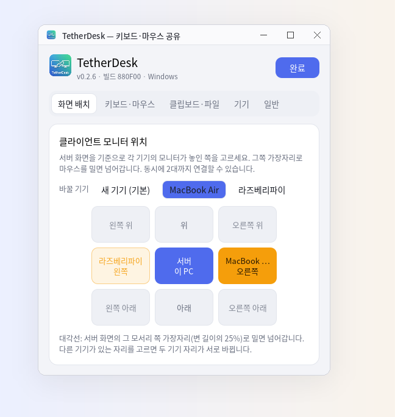
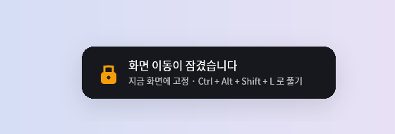
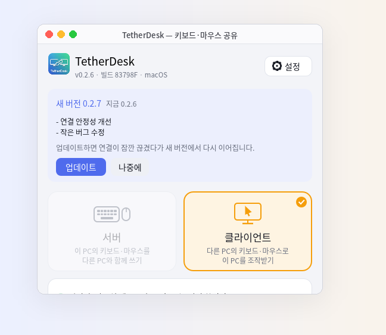

<p align="center">
  
</p>

<p align="center">
  
  
  
</p>

<p align="center">
  <a href="https://github.com/Kim-Jeong-Seok/tetherdesk-releases/releases/latest"><b>⬇ 최신 버전 받기</b></a>
</p>

# TetherDesk

> [!NOTE]
> 🦀 **Rust로 만든 바이브 코딩 프로젝트입니다.**<br>
> 무엇을 만들지 정하고, 실제 PC에서 써 보며 문제를 찾아낸 건 사람이 — 코드는 AI와 대화하며 함께 썼습니다.

책상 위 PC 여러 대를 **키보드·마우스 하나로** 쓰는 프로그램입니다.
마우스를 화면 끝으로 밀면 옆 PC로 넘어가고, 키보드 입력과 복사·붙여넣기도 같이 넘어갑니다.
윈도우 노트북에서 맥북으로, 맥북에서 라즈베리파이로 — 손을 옮기지 않고 그대로 이어서 작업하세요.

## 이런 걸 할 수 있어요

| 기능 | 설명 |
|---|---|
| 🖱️ **마우스·키보드 공유** | 화면 가장자리로 밀면 옆 PC로 넘어갑니다. 서버 1대에 클라이언트 2대까지 연결됩니다. |
| 📋 **복사·붙여넣기** | 글자, 이미지, 파일까지. 이 PC에서 복사하고 넘어가서 바로 붙여넣으면 됩니다. |
| 📁 **파일 보내기** | 창에 끌어다 놓으면 상대 PC로 보냅니다. 여러 개, 폴더도 됩니다. |
| 🔎 **자동 찾기** | 같은 공유기에 켜진 서버를 찾아서 보여 줍니다. 주소를 몰라도 됩니다. |
| 🔒 **화면 이동 잠금** | 게임·그림 작업 중 실수로 넘어가지 않게 단축키로 잠급니다. |
| 🛡️ **암호화 연결** | 모든 입력은 암호화돼서 오가고, 처음 연결할 때 확인 코드로 승인합니다. |
| 🔄 **자동 업데이트** | 새 버전이 나오면 알려 주고, 버튼 하나로 업데이트합니다. |

## 다운로드

[릴리스 페이지](https://github.com/Kim-Jeong-Seok/tetherdesk-releases/releases/latest)에서 내 PC에 맞는 파일을 받으세요.

| PC | 받을 파일 | 역할 |
|---|---|---|
| Windows 10 / 11 (64비트) | `TetherDesk.exe` | 서버 · 클라이언트 |
| macOS (Apple 실리콘 · 인텔) | `TetherDesk-버전-macOS.dmg` | 서버 · 클라이언트 |
| Linux (x86_64) | `TetherDesk-linux-x86_64` | 클라이언트 |
| 라즈베리파이 등 Linux (ARM64) | `TetherDesk-linux-arm64` | 클라이언트 |

> `TetherDesk-macOS.zip`과 `latest.json`은 자동 업데이트용 파일이라 받지 않아도 됩니다.

## 사용법

**서버**는 키보드·마우스가 연결된 PC, **클라이언트**는 그 키보드·마우스로 조작받을 PC입니다.

**1. 서버 켜기** — 키보드·마우스가 있는 PC에서 TetherDesk를 열고 **서버**를 고른 뒤 **서버 시작**을 누릅니다.

**2. 클라이언트 연결** — 다른 PC에서 **클라이언트**를 고르면 **근처**에 서버가 보입니다. 눌러서 고르고(또는 서버 주소 입력) **연결**을 누릅니다.

**3. 확인 코드로 승인** — 서버 PC에 승인 창이 뜹니다. 두 화면의 숫자가 같으면 **승인**. 한 번 승인한 기기는 다음부터 자동으로 연결됩니다.

<p align="center"></p>

**4. 화면 배치** — 서버의 **설정 → 화면 배치**에서 각 기기가 서버 화면의 어느 쪽에 있는지 고릅니다.
이제 그쪽 가장자리로 마우스를 밀면 넘어갑니다.

<p align="center">
  
  &nbsp;
  
</p>

## 단축키

| 동작 | Windows | macOS |
|---|---|---|
| **비상 복귀** — 지금 어디 있든 서버 PC로 돌아오기 | `Ctrl` + `Alt` + `Shift` + `Esc` | `Control` + `Option` + `Shift` + `Esc` |
| **화면 이동 잠금 / 해제** | `Ctrl` + `Alt` + `Shift` + `L` | `Control` + `Option` + `Shift` + `L` |

두 단축키 모두 **설정 → 키보드·마우스**에서 바꿀 수 있습니다. 잠그거나 풀면 화면 위에 잠깐 알림이 뜹니다.

<p align="center"></p>

## 처음 설치할 때

<details>
<summary><b>Windows</b></summary>

- 처음 실행하면 **"Windows의 PC 보호"** 창이 뜰 수 있습니다. 개인 프로젝트라 유료 코드 서명이 없어서입니다. **추가 정보 → 실행**을 누르세요.
- 방화벽 허용 창이 뜨면 **개인 네트워크**에 허용하세요.
- 작업 관리자처럼 **관리자 권한으로 실행된 창**이 맨 앞에 있으면 Windows 보안 때문에 키 입력이 넘어가지 않을 수 있습니다.

</details>

<details>
<summary><b>macOS</b></summary>

1. DMG를 열고 TetherDesk를 **응용 프로그램** 폴더로 끌어 놓습니다.
2. 처음 열 때 "확인되지 않은 개발자" 창이 뜨면, 앱을 **우클릭 → 열기**로 엽니다.
3. 권한을 켭니다 (시스템 설정 → 개인정보 보호 및 보안).
   - **macOS 27.3 이상**: **System & App Protection Override**에서 TetherDesk를 추가합니다. "Choose Apps…" 창이 뜨면 파란 [앱 선택]이 아니라 왼쪽의 **[Override System Protections]**를 누르세요. TetherDesk는 앞에 있는 아무 앱에나 입력을 넣어야 해서 전체 권한이 필요합니다.
   - **그 이전 macOS**: **손쉬운 사용**에서 TetherDesk를 켭니다.
   - 맥을 **서버**로 쓸 때는 **입력 모니터링**도 켭니다.
4. 권한을 켠 뒤 앱을 **다시 열어야** 적용됩니다. 앱 안의 **그림으로 설정 안내 보기**에서 화면을 보며 따라 할 수 있습니다.
5. "로컬 네트워크의 기기를 찾도록 허용" 창이 뜨면 **허용**하세요 (자동 찾기에 필요).

</details>

<details>
<summary><b>Linux (클라이언트)</b></summary>

받은 파일에 실행 권한을 주고 실행합니다.

```bash
chmod +x TetherDesk-linux-arm64
./TetherDesk-linux-arm64
```

키보드·마우스 입력을 넣으려면 `/dev/uinput` 권한이 필요합니다. 아래 명령을 한 번 실행하고 **로그아웃 후 다시 로그인**하세요 (앱 화면에도 같은 명령이 나오고 [복사] 버튼이 있습니다).

```bash
echo uinput | sudo tee /etc/modules-load.d/uinput.conf
sudo modprobe uinput
echo 'KERNEL=="uinput", GROUP="input", MODE="0660", OPTIONS+="static_node=uinput"' | sudo tee /etc/udev/rules.d/60-tetherdesk-uinput.rules
sudo usermod -aG input $USER
sudo udevadm control --reload-rules && sudo udevadm trigger
```

</details>

## 자동 업데이트

새 버전이 나오면 화면 위쪽에 알림이 뜹니다. **업데이트**를 누르면 받아서 새 버전으로 다시 켜지고, 연결 중이었다면 다시 이어집니다.
업데이트 후 처음 켤 때 바뀐 점을 보여 주며, **설정 → 일반 → 업데이트 내역 보기**에서 언제든 다시 볼 수 있습니다.

<p align="center"></p>

- 받은 파일은 **배포자 서명을 확인한 뒤에만** 설치합니다. 서명이 맞지 않으면 설치하지 않습니다.
- 설치는 [업데이트]를 눌렀을 때만 합니다. 몰래 바뀌지 않습니다.
- 맥은 **응용 프로그램** 폴더에서 실행 중이어야 업데이트할 수 있습니다.

## 알아 두세요

- 서버와 클라이언트는 **같은 네트워크**에 있어야 합니다. 떨어진 곳이면 Tailscale 같은 VPN으로 연결할 수 있습니다.
- 서버는 Windows · macOS에서만 됩니다. Linux는 클라이언트로만 쓸 수 있습니다.
- 맥↔아이패드 **유니버설 컨트롤**은 **맥을 서버로 쓸 때** 함께 쓸 수 있습니다. 맥의 트랙패드·마우스로 움직일 때만 아이패드로 넘어가는 Apple 기능이라, 다른 PC(예: 윈도우)를 서버로 두고 맥을 조작할 때는 아이패드로 넘어가지 않습니다.
  함께 쓸 때는 아이패드 위치(시스템 설정 → 디스플레이)와 TetherDesk 클라이언트 위치(설정 → 화면 배치)가 **같은 쪽에 겹치지 않게** 두세요.
- 회사 PC의 백신·보안 프로그램이 키보드 입력을 다루는 프로그램을 의심할 수 있습니다. 회사에서 쓸 때는 IT 담당자와 확인하세요.
- 키보드가 가끔 넘어가지 않는 등 문제가 있으면 **설정 → 일반 → 문제 해결**에서 **로그 보기**와 **키 기록**을 켜고, 재현한 뒤 로그의 **[복사]** 내용을 알려 주세요. (키 기록은 입력한 키가 로그에 남으니 확인이 끝나면 꺼 두세요.)

## 보안과 개인정보

- PC끼리 주고받는 모든 내용(키 입력, 마우스, 클립보드, 파일)은 **Noise 프로토콜로 암호화**됩니다.
- 처음 연결하는 기기는 양쪽 화면의 **확인 코드가 같을 때만** 승인합니다. 승인한 기기 목록은 **설정 → 기기**에서 관리합니다.
- 입력 내용을 저장하거나 인터넷으로 보내지 않습니다. 인터넷 연결은 업데이트 확인(GitHub)에만 씁니다.

---

<sub>TetherDesk는 개인 토이 프로젝트입니다 · Rust · egui · 이 저장소는 배포 파일 전용입니다.</sub>
